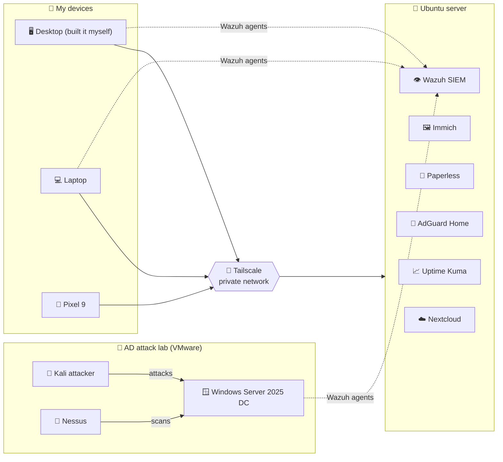

*Not all who tinker are lost.*

I'm most interested in how things break: vulnerabilities, attacks, and how to catch them. 
Most of what I learn, I learn by building it in my homelab first.

---

## ⚔️ The Fellowship of Skills

> *Every quest needs a company. These are mine.*

**🛡️ Defense and detection** 

**🗡️ Offense** 

**🏰 Systems and infrastructure** 

**🔮 AI** 

---

## 🗺️ Quests in Progress

| Quest | What it is | Status |
|---|---|---|
| 🏰 **Active Directory lab** | Build it, attack it, detect it. A Windows Server 2025 domain controller, a Kali attacker, Wazuh for detection and Nessus for scanning. | 🟡 Write-up coming |
| 🌋 **[Homelab](https://github.com/liamskillern/homelab)** | An Ubuntu server I run myself, with a Wazuh SIEM watching every machine I own. Map below, full write-up [here](https://github.com/liamskillern/homelab). | 🟢 Running |
| 🔮 **Ultron, my AI morning brief** | Claude Code reads my email and calendar and writes me a daily brief. See *The Palantír* below. | 🟡 Moving to the cloud |
| 🛡️ **FOCO Cyber** | Security help for small businesses in Fort Collins. | 🟡 Starting up |

---

## 🌍 Map of my Middle-earth (the homelab)

Everything is reached over Tailscale, so nothing is exposed to the open internet. The full tour lives in my [homelab repo](https://github.com/liamskillern/homelab).

---

## 🔮 The Palantír (what I'm building with Claude)

I'm learning to use Claude Code well, and I'm treating it like a security problem as much as a coding tool.

- **Ultron morning brief.** Claude Code runs on a schedule, reads my email and calendar, and writes a daily brief to my notes, then pings my phone.
- **Read-only by design.** An agent that reads email is a prompt-injection target: anyone who emails me can try to give it orders. So it only gets an allowlist of read-only tools, and it treats everything it reads as data, never as instructions.
- **This profile.** Designed by me, built with Claude Code, merged through a pull request.

> *Even the very wise cannot see all ends. That's why the agent doesn't get write access.*

---

## 📜 The Road to Security+

Target: **summer 2027**, CompTIA Security+ (SY0-701). I check off each domain as I finish it.

- [ ] 1. General Security Concepts
- [ ] 2. Threats, Vulnerabilities, and Mitigations
- [ ] 3. Security Architecture
- [ ] 4. Security Operations
- [ ] 5. Security Program Management and Oversight

---

## 🧭 Seeking a Fellowship

I'm looking for **internships and entry-level roles** in:

- 🛡️ **Cybersecurity:** SOC analyst, security operations
- 🖥️ **IT and help desk:** desktop support, systems administration
- 🔮 **AI:** AI operations, automation, and securing AI agents

- 🎓 B.S. Cybersecurity, **CSU Pueblo**, graduating Winter 2027
- 🎓 A.S. Cybersecurity, **Arapahoe Community College**
- 📍 Fort Collins, Colorado, open to remote

If you're hiring, [message me on LinkedIn](https://www.linkedin.com/in/liam-skillern/).

---

## 📊 Deeds recorded in the Red Book

*The road goes ever on.*

